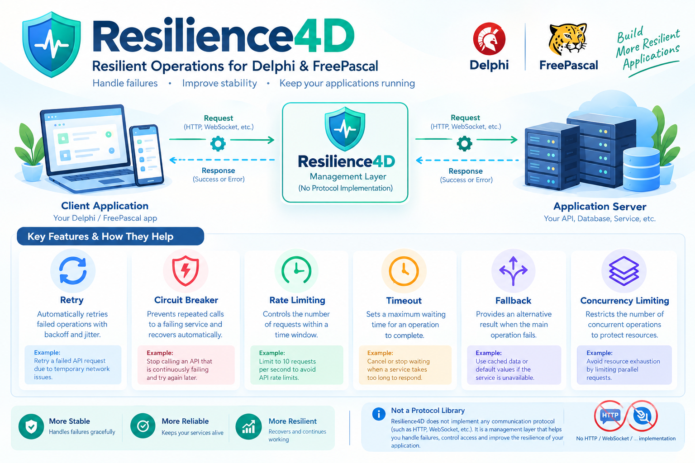

<div align="center">
  
</div>

# Resilience4D

**A dependency-light resilience toolkit for Delphi and FreePascal.**

Resilience4D wraps synchronous operations with common fault-tolerance mechanisms: retries, exponential backoff with jitter, circuit breaking, cooperative timeout budgets, cancellation checks, fixed-window rate limiting, concurrency limiting, fallbacks, diagnostic callbacks, thread-safe metrics, a bounded TTL string cache, a named policy registry, and a standalone retry executor with attempt/elapsed-time stopping and a retry predicate hook. Thread-safety guarantees are component-specific: configure policy/retry options before sharing, use one context per operation, and do not destroy a registry while consumers still use policies returned by it.

> **Project status:** early-stage, source-first library. The source and examples are provided for review and testing. Do not treat this release as production-certified until you compile it with your target compiler versions and run the test suite on your deployment platforms.

## Feature overview

| Capability | What it does | Important boundary |
|---|---|---|
| Retry | Repeats failed callbacks up to `MaxRetries` | Callback failures are not classified; set retries carefully |
| Exponential backoff | Grows delay between attempts and caps it | Synchronous wait blocks the calling thread |
| Jitter | Randomizes the delay to reduce synchronized retry storms | Pseudorandom jitter is not cryptographic |
| Circuit breaker | Closed / Open / Half-Open state machine | Per policy instance; concurrency probes are not a distributed lease |
| Timeout budget | Tracks elapsed and remaining time | Cooperative only; does not kill blocked code |
| Cancellation | Stops before attempts and while waiting for admission | Callback must cooperate once running |
| Fixed-window rate limit | Caps admissions per time window | In-process only; can burst at window boundaries |
| Concurrency limit | Caps active callbacks per policy instance | Uses short polling waits; not a task scheduler |
| Fallback | Runs a secondary callback after rejection/failure | Use only when degraded output is semantically safe |
| Diagnostics | Callback-based log events | Avoid blocking/re-entering the same policy in the logger |
| Metrics | Thread-safe counters + Prometheus text output | In-process only; no HTTP exporter included |
| TTL cache | Bounded, thread-safe string cache with expiry | Bounded in-process eviction; not LRU or distributed |
| Policy registry | Named policy instances | Do not remove/free policies while in use |
| Standalone retry executor | Max attempts, max elapsed budget, delay strategy, retry predicate and callback | Synchronous; callback controls which failures are retried |
| Exception handling | Converts operation/fallback exceptions to failure results | Exceptions are represented as text in `LastError` |

## Repository structure

```text
Resilience4D/
├── src/                         # Shared Delphi/FPC units
├── Examples/
│   ├── Delphi/                  # Each example has its own folder + README.md
│   └── FreePascal/              # Matching FPC examples, each with README.md
├── tests/                       # Lightweight test runner
├── docs/
│   ├── ARCHITECTURE.md
│   ├── DESIGN.md
│   ├── FEATURES.md
│   └── guides/PRODUCTION_GUIDE.md
├── LICENSE
└── README.md
```

## Quick start

Implement the callback contract. Return `True` for success. Return `False` and populate `AError` for a failure.

```pascal
uses
  SysUtils, Resilience4D.Types, Resilience4D.Policy;

type
  TInventoryClient = class
  private
    FCalls: Integer;
  public
    function LoadInventory(AContext: TObject; out AError: string): Boolean;
  end;

function TInventoryClient.LoadInventory(AContext: TObject; out AError: string): Boolean;
var
  C: TResilienceContext;
begin
  Inc(FCalls);
  C := TResilienceContext(AContext);
  { Configure the real HTTP client's timeout using C.RemainingTimeoutMS. }
  if FCalls < 3 then
  begin
    AError := 'Temporary upstream error';
    Exit(False);
  end;
  AError := '';
  Result := True;
end;

var
  Client: TInventoryClient;
  Policy: TResiliencePolicy;
  Context: TResilienceContext;
begin
  Client := TInventoryClient.Create;
  Policy := TResiliencePolicy.Create;
  Context := TResilienceContext.Create('inventory.load', 5000);
  try
    Policy.MaxRetries := 2;
    Policy.InitialDelayMS := 100;
    Policy.MaxDelayMS := 1500;
    Policy.BackoffMultiplier := 2.0;
    Policy.JitterPercent := 15;
    Policy.CircuitFailureThreshold := 5;
    if Policy.Execute(Client.LoadInventory, nil, Context) then
      Writeln('Inventory loaded')
    else
      Writeln('Request failed: ', Context.LastError);
  finally
    Context.Free;
    Policy.Free;
    Client.Free;
  end;
end.
```

## Examples

Each example now lives in its own directory under the compiler-specific folders, and every example directory includes a detailed `README.md` with purpose, concepts, build/run steps, expected behavior, and limitations. See [`Examples/README.md`](Examples/README.md) for the complete index. The examples are split into separate compiler-specific folders.

### Delphi

Open a `.dpr` file in Delphi, add `src` to the project search path, then build and run. Examples:

1. `Examples/Delphi/01_RetryAndBackoff/RetryAndBackoff.dpr` — transient failures and exponential backoff.
2. `Examples/Delphi/02_CircuitBreaker/CircuitBreaker.dpr` — open circuit and cached fallback.
3. `Examples/Delphi/03_TimeoutAndCancellation/TimeoutAndCancellation.dpr` — cooperative deadline checks.
4. `Examples/Delphi/04_RateAndConcurrency/RateAndConcurrency.dpr` — admission throttling.
5. `Examples/Delphi/05_LoggingAndContext/LoggingAndContext.dpr` — operation name, deadline and log callback.
6. `Examples/Delphi/06_FallbackCache/FallbackCache.dpr` — degraded response from a cache.
7. `Examples/Delphi/07_ConcurrencyLimit/ConcurrencyLimit.dpr` — concurrent callers and a shared admission cap.
8. `Examples/Delphi/08_Metrics/Metrics.dpr` — counters and Prometheus text exposition.
9. `Examples/Delphi/09_TTLCache/TTLCache.dpr` — bounded TTL cache.
10. `Examples/Delphi/10_PolicyRegistry/PolicyRegistry.dpr` — named reusable policies.
11. `Examples/Delphi/11_StandaloneRetry/StandaloneRetry.dpr` — standalone retry executor with a bounded attempt count.

### FreePascal

Equivalent `.lpr` programs are provided separately in `Examples/FreePascal/`:

1. `Examples/FreePascal/01_RetryAndBackoff/RetryAndBackoff.lpr` — retry and backoff.
2. `Examples/FreePascal/02_CircuitBreaker/CircuitBreaker.lpr` — circuit breaker and fallback.
3. `Examples/FreePascal/03_TimeoutAndCancellation/TimeoutAndCancellation.lpr` — cooperative timeout budget.
4. `Examples/FreePascal/04_RateAndConcurrency/RateAndConcurrency.lpr` — rate-limited admission.
5. `Examples/FreePascal/05_LoggingAndContext/LoggingAndContext.lpr` — diagnostics and operation context.
6. `Examples/FreePascal/06_FallbackCache/FallbackCache.lpr` — cache fallback.
7. `Examples/FreePascal/07_ConcurrencyLimit/ConcurrencyLimit.lpr` — multiple threads sharing a concurrency cap.
8. `Examples/FreePascal/08_Metrics/Metrics.lpr` — counters and Prometheus text exposition.
9. `Examples/FreePascal/09_TTLCache/TTLCache.lpr` — bounded TTL cache.
10. `Examples/FreePascal/10_PolicyRegistry/PolicyRegistry.lpr` — named reusable policies.
11. `Examples/FreePascal/11_StandaloneRetry/StandaloneRetry.lpr` — standalone retry executor with a bounded attempt count.

Compile from the repository root using FPC:

```sh
mkdir -p build
fpc -Mdelphi -Fu./src -FE./build ./Examples/FreePascal/01_RetryAndBackoff/RetryAndBackoff.lpr
./build/01_RetryAndBackoff
```

Repeat for the other `.lpr` files in their individual example folders. The concurrency example creates worker threads and prints the maximum number of callbacks observed at once. On Windows, use the generated `.exe` filename. The included workflow builds every example and runs the test program.

### Tests

1. `tests/Resilience4D.Tests.dpr` - Delphi tests
2. `tests/Resilience4D.Tests.lpi` - FreePascal tests

A successful test run prints a `PASS` line for each assertion. Delphi compilation must be performed in an available Delphi environment; it is not possible to validate Delphi compiler compatibility from an FPC-only CI runner.

## API summary

### `TResiliencePolicy`

- `MaxRetries`: number of retries after the initial attempt; `2` means at most 3 calls.
- `InitialDelayMS`, `MaxDelayMS`, `BackoffMultiplier`, `JitterPercent`: retry-delay settings.
- `CircuitBreakerEnabled`, `CircuitFailureThreshold`, `CircuitOpenDurationMS`, `CircuitHalfOpenSuccessThreshold`: circuit-breaker settings.
- `DefaultTimeoutMS`: applied when no timeout is set on the supplied context.
- `RateLimitMaxRequests`, `RateLimitWindowMS`: fixed-window rate limit; non-positive max disables it.
- `MaxConcurrentOperations`: maximum active callbacks; non-positive disables it.
- `RetryOnFailure`, `RetryOnTimeout`: control retry behaviour.
- `OnLog`: callback for diagnostic events.
- `Execute(Operation, Fallback, Context)`: execute a callback with policies and optional fallback.
- `ResetCircuit`: manually return the circuit to Closed.
- `CircuitState`: current state (`rcsClosed`, `rcsOpen`, `rcsHalfOpen`).

### `TResilienceContext`

The context exposes `OperationName`, `TimeoutMS`, `Attempt`, `LastError`, `Cancel`, `IsCancelled`, `IsTimedOut` and `RemainingTimeoutMS`. The caller owns a context passed to `Execute`; when omitted, the policy creates a temporary context internally.

## Expanded feature research

See [Feature Parity and Research](docs/FEATURE_PARITY.md) for the design lessons taken from established projects such as Polly, Resilience4j and Tenacity, plus an explicit list of features not yet implemented.

## Timeout semantics — read before use

Resilience4D does **not** forcibly terminate an arbitrary synchronous Pascal method. It tracks a cooperative time budget and checks it between attempts/waits. A callback that blocks forever will still block the calling thread. For HTTP, socket and database operations, set the underlying driver's own timeout using `RemainingTimeoutMS` and check cancellation between work units.

## Production safety notes

- Do not retry payments, order creation, or other non-idempotent writes unless the remote API provides idempotency guarantees.
- Configure transport-level timeouts as well as the resilience budget.
- Keep retries conservative and use backoff plus jitter.
- Use separate policy instances for dependencies with different health/rate characteristics.
- Treat fallback data as potentially stale and document degraded behaviour.
- Do not log credentials, tokens, payment data or personal information.
- Set policy configuration before sharing the instance across threads; avoid mutating public configuration fields during active calls.
- Rate and concurrency state are local to one process and policy instance; this is not a distributed limiter.

## Compatibility

The units are intended to share source between modern Delphi and FreePascal in Delphi mode and avoid third-party dependencies. Actual compatibility depends on compiler version, RTL implementation and target platform. Run the examples and tests with the exact toolchains you plan to support.

## Support Resilience4D

If you find WebSocket4D useful, please consider supporting its continued development with a voluntary cryptocurrency donation.

Your support helps me maintain the library, improve its documentation and examples, fix bugs, and develop new features.

**BNB Donations**

Network: **BNB Smart Chain (BEP-20)**

Wallet address: `0xcB3324b1154CCdB9C497BbfeDd277Ed93407E519`


Scan the QR code with your wallet app to donate.

Donations are entirely optional. Resilience4D remains free and open-source.

Thank you for supporting Resilience4D!

*Created by Shaahin Ashayeri*

---

**Resilience4D** · Delphi + FreePascal · Windows ·
